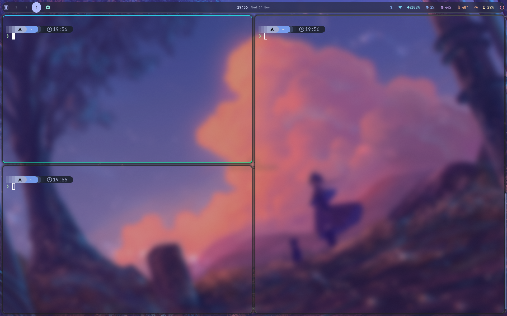
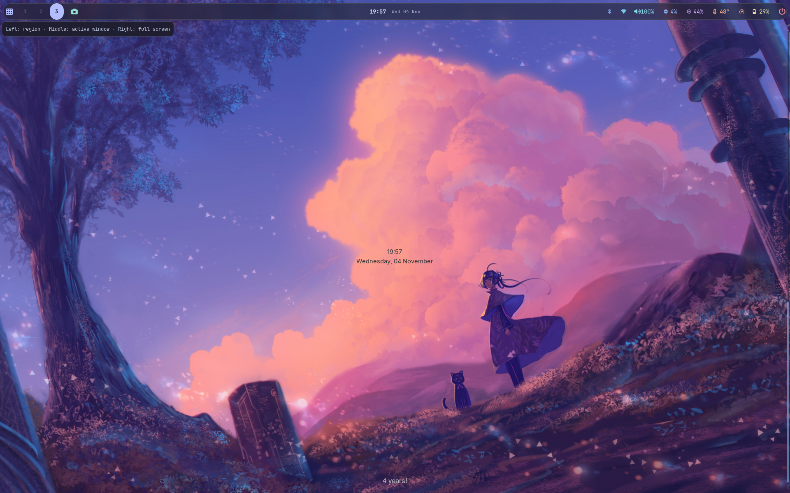
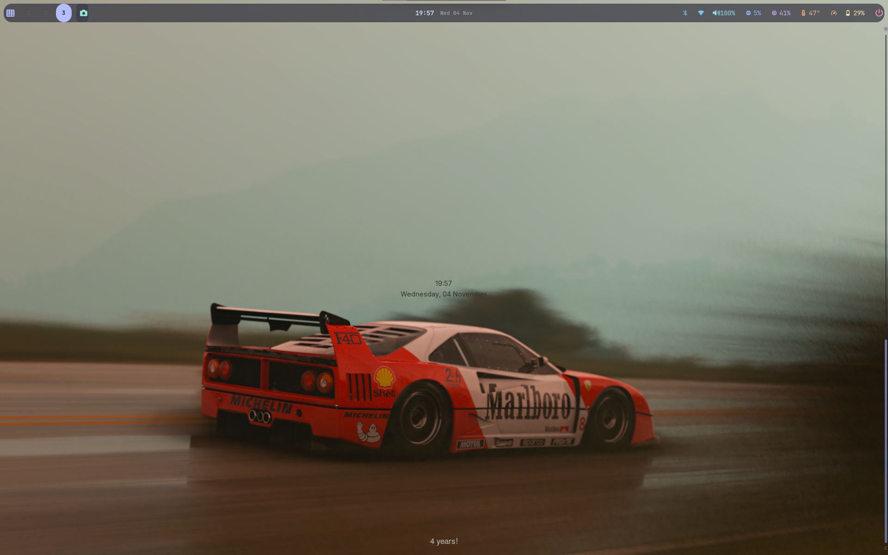
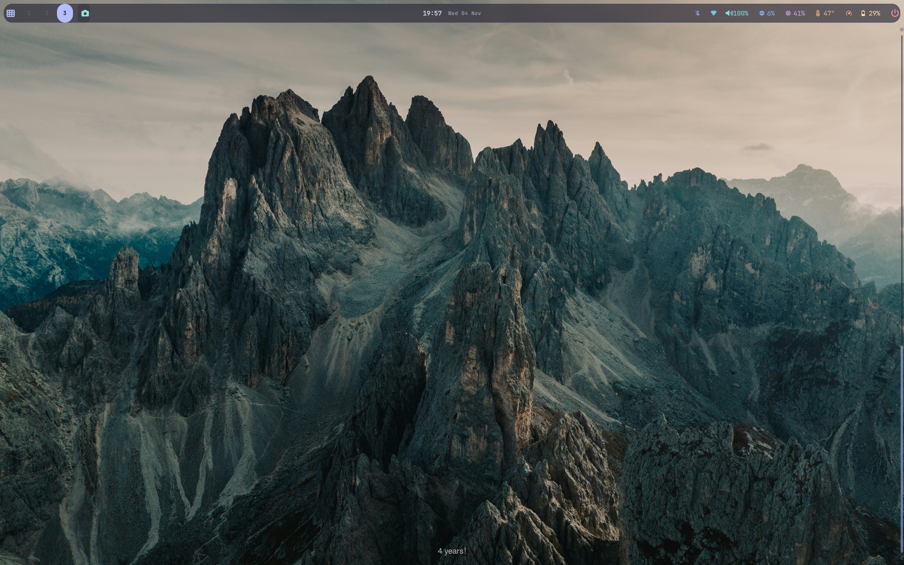

# 🌌 Solar's Hyprland Dots

A personal **Hyprland + Wayland** rice — clean, fast, and daily-driven. Lua-based Hyprland config, Catppuccin/Mocha theming, multi-monitor aware, with a full set of helper scripts (wallpapers, screenshots, brightness, dropdown terminal, screen rotation, and more).


> ⚠️ **Heads up:** This is my personal config. It's tuned for my machine (multi-monitor, laptop panel + 4K displays). Review and adapt paths/monitors before installing.

---

## ✨ Features

- **Hyprland** (Lua config) — single `hyprland.lua` with all modules inline
- **Waybar** — per-output bars (4K vertical + laptop horizontal), Catppuccin Mocha
- **Alacritty** — blurred, translucent terminal
- **Kitty** — alternate terminal
- **Rofi** — app launcher, power menu, wallpaper picker, applets
- **SwayNC** — notification center
- **Swaylock** — lock screen (swaylock-effects)
- **Waypaper + hyprpaper** — wallpaper management & restore
- **Quickshell** — brightness OSD
- **Fastfetch** — system info
- **Starship** — shell prompt
- **Helper scripts** — screenshots, brightness, monitor scale, screen invert/rotation, wallpaper cycle, dropdown terminal, power menu, desktop clock, waybar calendar

## 📸 Screenshots









## 📦 What's included

```
hyprland-dots/
├── alacritty/          # terminal
├── fastfetch/          # system info
├── hypr/               # Hyprland config + scripts + hyprlock
├── kitty/              # alternate terminal
├── quickshell/         # brightness OSD
├── rofi/               # launcher, powermenu, applets, themes
├── swaylock/           # lock screen
├── swaync/             # notifications
├── waybar/             # status bar + colors
├── waypaper/           # wallpaper manager
├── starship.toml       # shell prompt
├── .bashrc .zshrc ...  # shell configs
├── install.sh          # automated installer (curl-friendly)
└── README.md
```

## 🚀 Installation

### One-liner (recommended)

```bash
curl -fsSL https://raw.githubusercontent.com/solar23040/hyprland-dots/main/install.sh | bash
```

### Manual

```bash
git clone https://github.com/solar23040/hyprland-dots.git
cd hyprland-dots
./install.sh
```

### Custom locations

```bash
CONFIG_DIR="$HOME/.config" REPO_DIR=/path/to/repo ./install.sh
```

The installer:
- Backs up your existing configs to `~/.config-backup-<timestamp>/`
- Copies all configs into `~/.config`
- Installs shell + starship configs into `$HOME`
- Makes helper scripts executable

## 🧰 Dependencies

### Arch Linux (recommended)

```bash
sudo pacman -S hyprland waybar alacritty rofi swaylock fastfetch kitty \
  swaync waypaper quickshell starship hyprpaper grim slurp wl-clipboard \
  playerctl brightnessctl ttf-jetbrains-mono-nerd bibata-cursor-theme
```

Plus AUR helpers for `swaylock-effects` and `hyprshot` (optional).

### Debian / Ubuntu

```bash
sudo apt install hyprland waybar alacritty rofi swaylock fastfetch kitty
```

### Fedora

```bash
sudo dnf install hyprland waybar alacritty rofi swaylock fastfetch kitty
```

> Only tested on Arch. Other distros may need package name adjustments.

## ⌨️ Keybindings (highlights)

| Key | Action |
|---|---|
| `Super + Return` | Open terminal (Alacritty) |
| `Super + Shift + Return` | Dropdown terminal |
| `Super + Q` | Close window |
| `Super + M` | Exit Hyprland |
| `Super + E` | File manager |
| `Super + V` | Toggle float |
| `Super + R` | Restart Waybar |
| `Super + Space` | Rofi launcher |
| `Super + W` | Cycle wallpaper |
| `Super + Shift + W` | Wallpaper picker (rofi) |
| `Super + I` | Invert laptop screen |
| `Super + P` | Power menu |
| `Super + B` | Browser (Brave Origin) |
| `Super + L` | Lock screen |
| `Super + F` | Fullscreen |
| `Super + S` | Scratchpad toggle |
| `Ctrl + = / -` | Scale focused monitor |
| `Print` / `Shift+Print` / `Super+Print` | Screenshot (region / window / full) |
| `XF86Audio*` | Volume & media controls |
| `XF86MonBrightness*` | Brightness |

Full list: `hypr/modules` → now inlined in `hypr/hyprland.lua`.

## 🔙 Restore backup

If something breaks:

```bash
cp -r ~/.config-backup-<timestamp>/* ~/.config/
```

Or re-run the installer after fixing.

## 🛠️ Troubleshooting

- **Waybar doesn't start** → check `~/.config/waybar/config.jsonc` for JSONC errors; run `waybar` in a terminal.
- **Scripts not executable** → `chmod +x ~/.config/hypr/scripts/*`
- **Fonts missing** → install a Nerd Font (JetBrainsMono Nerd Font).
- **Cursor theme** → install `bibata-cursor-theme` or change `XCURSOR_THEME` in `hyprland.lua`.
- **Monitor layout** → edit the `hl.monitor({...})` block at the top of `hypr/hyprland.lua`.

## 📝 Notes

- Default terminal in Hyprland is Alacritty (kitty kept as fallback).
- `hyprland.lua` is a single self-contained file (no separate modules).
- Wallpapers expected in `~/Pictures/Wallpapers`.
- Tested on Arch Linux only.

## 🤝 Contributing

PRs and issues are welcome! Feel free to fork and adapt.

## 📜 License

GNU AGPL v3 — see [LICENSE](LICENSE).
